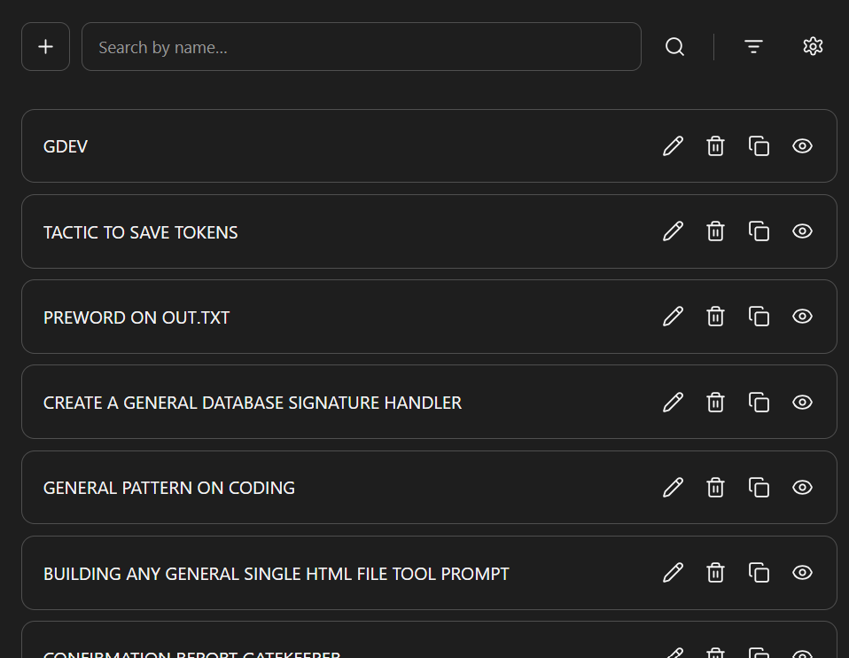

# Prompt Database Extension

A small Chrome extension for keeping your most-used prompts in one place. Save a prompt once, then copy it into whichever AI you're using.

Click the extension icon to open it. Click outside to close it. That's it.

## What it does

- Add, edit, delete and copy prompts.
- Search by name, with fuzzy matching for small typos. Press Enter or click the search button to run a search.
- Sort by name, creation date or edit date, in either direction.
- Change the background and text colors.
- Export and import prompts, settings or both as a JSON file.
- Keep everything locally in your browser using IndexedDB.

No account, API key or AI subscription is needed to use the extension. It stores your prompts; you choose where to paste them.

## Install

1. Open the [latest release](https://github.com/germanter/prompt-database-extension/releases/latest) and download the extension ZIP from Assets.
2. Extract it somewhere you plan to keep it.
3. Open `chrome://extensions` in Chrome.
4. Turn on **Developer mode** in the top-right corner.
5. Click **Load unpacked** and select the extracted folder containing `manifest.json`.
6. Pin **Prompt Database** from Chrome's extensions menu so it's easy to reach.

Click its icon to open the popup. It stays under the toolbar instead of opening another tab or window.

## Use it

Click **+**, give your prompt a name, add its content and save it.

Click a prompt to read it, or use the buttons beside it to edit, delete, copy or view it. Names can be up to 200 characters. Prompt content has no app-imposed character limit.

## Move your prompts between browsers

In the old browser:

**Settings -> Export data -> Prompts + settings**

In the new browser:

**Settings -> Import data -> Prompts + settings**

Choose the JSON file you exported. You can also move just the prompts or just the settings.

This is a manual transfer, not automatic sync. Each browser profile keeps its own data. If you used the original HTML tool, you can move its data into the extension the same way.

Importing adds new prompts and updates records with matching IDs. It doesn't wipe the rest of your collection.

## Versions

The current extension version is **v1.0.1**.

Each prompt also keeps the version it was created with:

- Older v1.0.0 prompts still show **Prompt v1.0.0** after importing.
- New prompts show **Prompt v1.0.1**.
- Editing an old prompt doesn't change its version.
- **Engine v1.0.1** is the version of the app you're running.

## Update without losing your data

Replace the files inside the same extension folder, then open `chrome://extensions` and click the extension's reload button.

Keep that folder in the same location. Don't uninstall the extension to update it. Uninstalling removes its local data, so export a backup first if you need to remove it.

## Local storage

Prompts and settings stay in your browser profile. The extension works offline and doesn't send them to a server.

It uses clipboard permission for the copy buttons and unlimited storage permission for its local database. It doesn't need access to the websites you visit.
